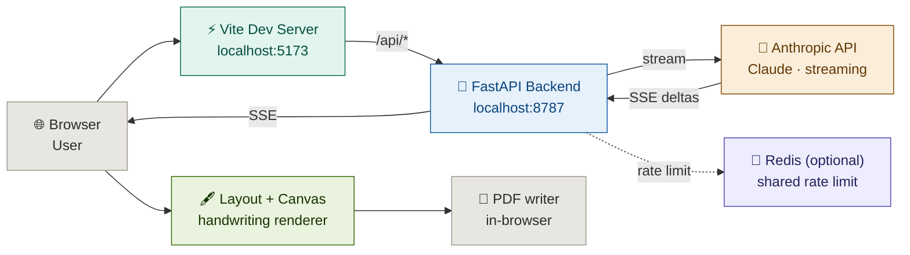

<div align="center">

[](https://github.com/ria0304/PaperPilot)


# PaperPilot — Questions In, Handwritten Pages Out


**Type it. Upload the question paper. Get a handwritten-style assignment you can print.**

PaperPilot turns a question, an assignment brief, or a photo of a question paper into a written answer, then renders it as realistic handwritten A4 pages — with your choice of handwriting, ink, paper, margins and a scanned look — and exports the result as a PDF straight from the browser.

</div>

---

## The Problem

Handwritten assignments are still a requirement in many courses, and they cost a lot of time for very little learning.

**Students** spend hours drafting an answer, copying it out neatly, fixing mistakes, and re-ruling pages when the handwriting drifts or runs out of room.

**Everyone** loses time on formatting: margins, headers, page breaks, diagrams that have to be redrawn by hand.

---

## The Solution

PaperPilot closes the gap between "I know what the question is" and "I have clean pages in front of me".

A user provides input in one of three ways:

- **Text** — type or paste the question or assignment
- **Question paper image** — upload a PNG, JPEG or WebP photo of the paper
- **Text file** — load a `.txt` / `.md` file of questions

The system outputs:

- An **AI-written answer** in simple, student-friendly language, with one heading per question (short, medium or long)
- A fully **editable answer box** — change any line and the pages re-render instantly
- **Handwritten A4 pages** drawn on canvas with per-line variation, so no two lines look stamped
- **Diagrams** for binary search tree answers, drawn by hand-style strokes
- **Saved drafts** you can reopen later
- A **downloadable PDF**, built entirely in the browser

---

## Core User Flow

```
User input (text / question-paper image / .txt file)
        ↓
Subject + answer length chosen (short ≈120 · medium ≈300 · long ≈600 words)
        ↓
POST /api/generate  →  FastAPI validates, rate-limits, builds the prompt
        ↓
Claude streams the answer back over Server-Sent Events
        ↓
Answer text appears live in the editor (edit freely)
        ↓
Layout engine: word-wrap, headings, bullets, numbered steps, page breaks
        ↓
Canvas renderer: paper + wobbly ink strokes + margin + header + page numbers
        ↓
PDF writer (in-browser) → one JPEG-backed A4 page per canvas → download
```

---

## Features

| Feature | Status |
|---|---|
| Text, question-paper image, or `.txt` / `.md` input | ✅ |
| Streaming AI answers over SSE (words appear as they are written) | ✅ |
| Subject hint + three answer lengths (short / medium / long) | ✅ |
| Multi-question papers — each answer starts with a `# Q1.`-style heading | ✅ |
| Editable answer box with live re-render | ✅ |
| 10 handwriting fonts (Caveat, Kalam, Patrick Hand, Indie Flower, …) | ✅ |
| 5 inks (blue, black, blue-black, red, pencil) | ✅ |
| 6 paper styles (ruled, plain, graph, dotted, engineering, custom image) | ✅ |
| Size, natural-variation and line-spacing sliders | ✅ |
| Left / centre / right / justified alignment | ✅ |
| Red margin line, adjustable left + right margins | ✅ |
| Name + date header on every page, page numbers | ✅ |
| "Scanned look" (paper grain + binding shadow) | ✅ |
| Hand-drawn binary search tree diagrams from `[bst 50 30 70 …]` | ✅ |
| "New handwriting variation" (re-seeds the randomness) | ✅ |
| Zoom, Edit / Preview views | ✅ |
| Client-side PDF export (A4, no server round-trip) | ✅ |
| Pen pressure (heavier and lighter words) and ink bleed (soft edges, ink pools) | ✅ |
| Save and reopen assignments (drafts, Ctrl/Cmd + S) | ✅ |
| Settings remembered between visits (localStorage) | ✅ |
| React + Tailwind interface | ✅ |
| Live backend status pill (AI ready · No API key · Server offline) | ✅ |
| Rate limiting (12 requests/min per IP) — in-memory, or shared across workers with Redis | ✅ |

---

## Handwriting Engine

The renderer is a from-scratch canvas pipeline (`frontend/src/layout.js` + `draw.js`) — no handwriting model, no images of letters.

- **Layout** measures real text widths in the chosen font, wraps words, splits over-long tokens, handles `#` / `##` headings, `-` bullets and `1.` numbered steps, and starts a new page when the lines run out. Each font has its own scale factor so every font fills the line height naturally.
- **Drawing** uses a seeded random generator (`mulberry32`) keyed on seed + page + line. Every line gets slight baseline drift, size and slant jitter, controlled by the *Natural variation* slider. Because the seed is fixed, the pages are stable between renders; the *New handwriting variation* button just picks a new seed.
- **Pen pressure** adds a smooth heavy-to-light drift along each line plus per-word noise. Harder presses draw a slightly thicker, darker stroke; light touches are thinner and paler. It has its own random stream, so turning it up or down never moves the words.
- **Ink bleed** feathers the edge of every letter and leaves the occasional small ink pool where the pen rests at the start of a word. Set both sliders to 0 for the crisp look.
- **Strokes** for underlines, margin lines and diagram edges are drawn as wobbly quadratic curves rather than straight lines, so they look pen-drawn.
- **Paper** is drawn procedurally (ruled, graph, dotted, engineering grid) or from an uploaded background image. The scanned look adds grain and a binding shadow on top.

---

## Saved Drafts

The **Drafts** tab (or **Save draft** in the header, or Ctrl/Cmd + S) stores the current assignment: the question, the answer, and every handwriting and paper setting. Saving again updates the open draft; **Save as new** makes a copy. Drafts are listed newest first and can be opened or deleted at any time (up to 50).

Drafts live in this browser's `localStorage`, so nothing is sent to the server and they do not follow you to another device. An uploaded paper background and an attached question paper image are not saved.

---

## Diagrams

If the model is asked about a binary search tree, it may add one line like:

```
[bst 50 30 70 20 40 60 80]
```

PaperPilot inserts the keys in order (up to 15), lays the tree out by inorder position and depth, and draws nodes and edges by hand-style strokes inline with the answer. Other topics are text-only.

---

## PDF Export

`frontend/src/pdf.js` is a small PDF 1.4 writer. Each page canvas (1240 × 1754 px, A4 at ~150 dpi) is encoded as a JPEG (quality 0.92), embedded as an image XObject on a 595.28 × 841.89 pt page, and the pages are stitched into one file. It runs fully in the browser — no server round-trip, nothing uploaded.

---

## Architecture



In production there is no Vite server: `npm start` builds the frontend and FastAPI serves `frontend/dist` and `/api` from a single port.

---

## Tech Stack

**Frontend**
- React 19 + Vite
- Tailwind CSS 3 (theme colours come from CSS variables, with automatic dark mode)
- Canvas 2D engine for pages, ink and diagrams (plain JS modules, no framework inside)
- Hand-written PDF 1.4 writer
- `localStorage` for settings and saved drafts

**Backend**
- FastAPI (Python 3.10+) + uvicorn
- Anthropic Python SDK (`AsyncAnthropic`) with streaming
- Server-Sent Events over `StreamingResponse`
- Pydantic request validation
- Sliding-window rate limiter: in-memory by default, Redis (`redis.asyncio`, atomic Lua script) when `REDIS_URL` is set
- `python-dotenv` for configuration

---

## Project Structure

```
PaperPilot/
│
├── backend/                          # Python server
│   ├── main.py                       # FastAPI app: /api/generate (SSE), /api/health, rate limiting, static serving
│   ├── requirements.txt              # fastapi, uvicorn, anthropic, python-dotenv, pydantic, redis
│   └── .env.example                  # Environment variable template
│
├── frontend/                         # React + Tailwind app (Vite)
│   ├── index.html                    # Mounts #root, loads the handwriting fonts
│   ├── vite.config.js                # React plugin, dev server on 5173, proxies /api to localhost:8787
│   ├── tailwind.config.js            # Theme colours + fonts
│   ├── postcss.config.js
│   └── src/
│       ├── main.jsx                  # Entry point
│       ├── App.jsx                   # Layout, tabs, PDF download, Ctrl/Cmd + S
│       ├── index.css                 # Tailwind layers, colour variables, component styles
│       ├── components/
│       │   ├── Header.jsx            # Brand, backend status pill, Save draft, Download PDF
│       │   ├── WriteTab.jsx          # Question, upload, generate (SSE), answer editor
│       │   ├── HandwritingTab.jsx    # Fonts, size, variation, spacing, pressure, bleed, ink, alignment
│       │   ├── PaperTab.jsx          # Paper, margins, header, page numbers, scanned look
│       │   ├── DraftsTab.jsx         # Save, reopen and delete drafts
│       │   ├── Preview.jsx           # Page canvases, zoom, "new handwriting variation"
│       │   ├── Toast.jsx
│       │   └── ui.jsx                # Small form controls
│       ├── state.js                  # Settings store (read by the engine, subscribed to by React) + persistence
│       ├── drafts.js                 # Draft storage (localStorage)
│       ├── hooks.js                  # useStore, useServerStatus
│       ├── toast.js, canvases.js     # Toast store, live canvas list for the PDF export
│       ├── config.js                 # Page size, fonts, inks, papers, sample question + answer
│       ├── api.js                    # Backend client: health check + SSE stream reader
│       ├── layout.js                 # Word-wrap, headings, lists, pagination, BST parsing
│       ├── draw.js                   # Paper, ink strokes, pressure, bleed, margins, header, scan effect, diagrams
│       └── pdf.js                    # Browser PDF writer + download helper
│
├── package.json                      # Root scripts: install:all, dev:*, build, start
├── .gitignore
└── README.md
```

---

## Run Locally

Both the frontend and backend run at the same time. The Vite dev server proxies every `/api/*` request to `localhost:8787`, so no CORS setup is needed in development.

**Step 1 — Clone and install**

```bash
git clone https://github.com/ria0304/PaperPilot.git
cd PaperPilot
npm run install:all     # npm install for the frontend + pip install -r backend/requirements.txt
```

**Step 2 — Set up environment**

```bash
cp backend/.env.example backend/.env
```

Open `backend/.env` and add your Anthropic API key (get one at https://console.anthropic.com):

```env
ANTHROPIC_API_KEY=sk-ant-xxxxxxxxxxxxxxxx
```

**Step 3 — Start the backend** (Terminal 1)

```bash
npm run dev:backend
```

You should see:
```
INFO:     Uvicorn running on http://127.0.0.1:8787 (Press CTRL+C to quit)
INFO:     Application startup complete.
```

**Step 4 — Start the frontend** (Terminal 2)

```bash
npm run dev:frontend
```

**Step 5 — Open the app**

```
http://localhost:5173
```

The status pill in the header should read **AI ready**.

**Optional — Redis rate limiting.** By default the 12-requests-per-minute limit is counted in memory, which is fine for a single process. If you run several workers or servers, point them at one Redis so they share the count:

```env
REDIS_URL=redis://localhost:6379/0
```

If Redis becomes unreachable the backend logs it once and falls back to the in-memory limiter rather than failing requests.

**Production (single port)**

```bash
npm start     # builds the frontend, then FastAPI serves frontend/dist and /api on :8787
```

---

## Verify the backend is working

```bash
# interactive API docs
http://localhost:8787/docs
```

```bash
curl http://localhost:8787/api/health
```

```bash
curl -N -X POST http://localhost:8787/api/generate \
  -H "Content-Type: application/json" \
  -d '{
    "question": "Explain the working of a Binary Search Tree with an example.",
    "subject": "Data Structures",
    "length": "short"
  }'
```

You should see a stream of `data: {"type":"delta","text":"..."}` events, ending with `{"type":"done","truncated":false}`.

`/api/health` also reports which rate limiter is active: `"rateLimit": "memory"` or `"redis"`.

---

## Common Issues

| Problem | Fix |
|---|---|
| Status pill says **No API key** | Add `ANTHROPIC_API_KEY` to `backend/.env` and restart the backend |
| Status pill says **Server offline** | Start the backend first (`npm run dev:backend`) |
| Port 8787 already in use | `lsof -i :8787` to find the process, kill it, then restart |
| `ModuleNotFoundError` on startup | Run `pip install -r backend/requirements.txt` again |
| Handwriting font looks wrong at first load | Fonts load on demand; the pages re-render as soon as the font is ready |
| "Too many requests" | The limit is 12 generations per minute per IP — wait a moment |
| Image upload rejected | Use PNG, JPEG or WebP, roughly 5 MB or smaller |
| Drafts missing | Drafts are stored per browser. Clearing site data, using a private window, or switching browser/device means they are not there |
| `ModuleNotFoundError: redis` | You set `REDIS_URL` but did not install the new requirement: `pip install -r backend/requirements.txt` |
| Production page is blank | Run `npm run build` so `frontend/dist` exists before starting the backend |

---

## Deployment

Single process, single port: `npm start` builds the frontend and FastAPI serves both the static files and the API. The app keeps no database — settings and drafts live in the browser's `localStorage` and nothing is stored on the server. There is no Dockerfile in this repository.

Running more than one worker (`uvicorn --workers N`) or more than one server? Set `REDIS_URL` so they share one rate-limit count. Without it each process keeps its own count and the effective limit is multiplied.

If you put it behind a reverse proxy, run uvicorn with `--proxy-headers` so the rate limiter sees the real client IP instead of the proxy's.

---

## Environment Variables

| Variable | Required | Description |
|---|---|---|
| `ANTHROPIC_API_KEY` | ✅ | API key from [console.anthropic.com](https://console.anthropic.com). Stays on the server; the browser never sees it |
| `ANTHROPIC_MODEL` | No | Model used for answers (default: `claude-sonnet-5-5`) |
| `REDIS_URL` | No | Share rate-limit counters across workers/servers, e.g. `redis://localhost:6379/0`. Empty = in-memory limiter |
| `PORT` | No | Port when started with `python main.py` (default: `8787`) |
| `CORS_ORIGINS` | No | Comma-separated origins allowed to call the API in dev (default: `http://localhost:5173`) |
| `VITE_API_BASE` | No | Frontend only — point the client at a backend on a different origin (default: same origin) |

---

## API Endpoints

| Method | Endpoint | Description |
|---|---|---|
| `POST` | `/api/generate` | Generate an answer from text or one image. Streams the result as Server-Sent Events. Rate-limited to 12/min per IP |
| `GET` | `/api/health` | Service status: `{ ok, configured, model, rateLimit }` — `rateLimit` is `memory` or `redis` |

**`POST /api/generate` request**

```json
{
  "question": "string (up to 20,000 characters)",
  "subject": "string (up to 80 characters)",
  "length": "short | medium | long",
  "image": { "mediaType": "image/png | image/jpeg | image/webp", "data": "<base64>" }
}
```

Send `question`, `image`, or both. If an image is present it is treated as the question paper.

**SSE events**

| Event | Payload |
|---|---|
| `delta` | `{ "type": "delta", "text": "…" }` — next chunk of the answer |
| `done` | `{ "type": "done", "truncated": false }` — `true` if the length cap cut the answer short |
| `error` | `{ "type": "error", "code": "rate_limited \| too_large \| failed" }` |

**Error responses (before streaming starts)**

| Status | Body | Meaning |
|---|---|---|
| `400` | `{ "code": "bad_request" }` | No question or image, or malformed body |
| `413` | `{ "code": "too_large" }` | Request body over 8 MB |
| `429` | `{ "code": "rate_limited" }` | More than 12 requests in a minute |
| `503` | `{ "code": "no_key" }` | `ANTHROPIC_API_KEY` is not set |

---

## Known Limitations

- **It is a renderer, not real handwriting.** Pages are drawn from font glyphs with controlled randomness. They look natural at a glance but are not a model of any one person's writing.
- **Only one diagram type.** Binary search trees are drawn; every other diagram request falls back to text.
- **AI answers need review.** The answer is generated text — check the facts and make sure the work follows your course's rules before you submit anything.
- **Rate limiter needs Redis to be shared.** Without `REDIS_URL` it is per process: it resets on restart and each worker counts separately. If Redis goes down mid-run it falls back to that in-memory behaviour.
- **No accounts, drafts stay in one browser.** Nothing is saved server-side, so drafts and settings do not sync between devices and are lost if you clear site data. Drafts are capped at 50.
- **Custom paper is not remembered.** An uploaded paper background is not saved in settings or drafts and falls back to ruled paper after a reload or when a draft is opened.
- **Pressure and bleed are simulated.** They are drawn from font glyphs with filters and noise, not from real pen data.
- **Image answers cost more.** Question-paper images get double the token budget and take longer than text input.
- **Local / single-server only.** No Dockerfile and no hosted deployment.

---

## Future Scope

| Feature | Why |
|---|---|
| More diagram types (graphs, flowcharts, tables) | Cover more subjects than data structures |
| Multi-language handwriting fonts | Support Hindi and other scripts |
| Sync drafts across devices (accounts + server storage) | Open an assignment on any device |
| Export / import drafts as files | Back up drafts and move them between browsers |
| Docker | Reproducible deployment |
